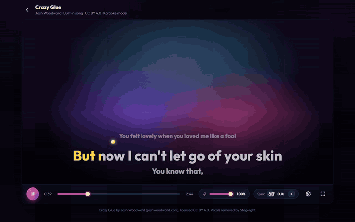
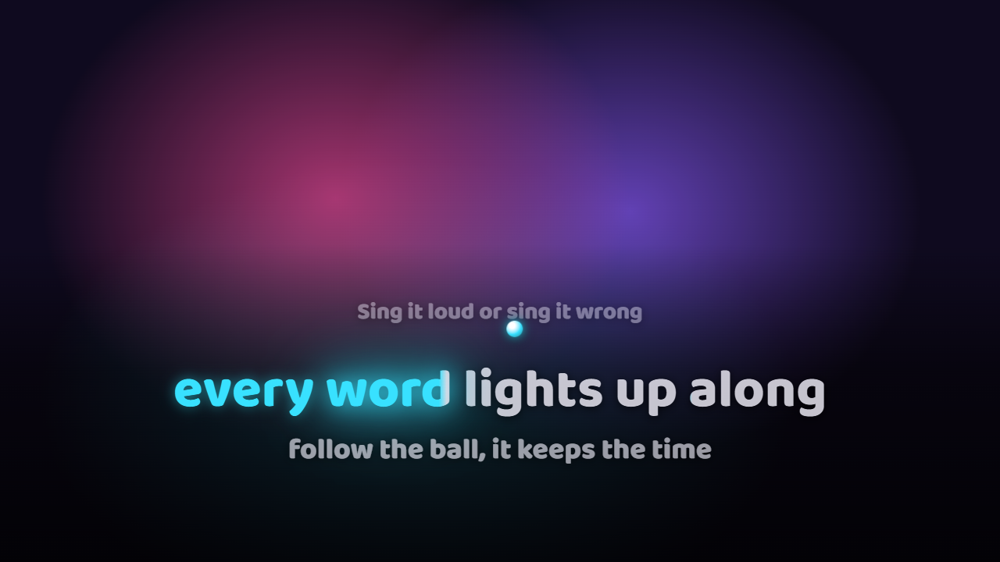
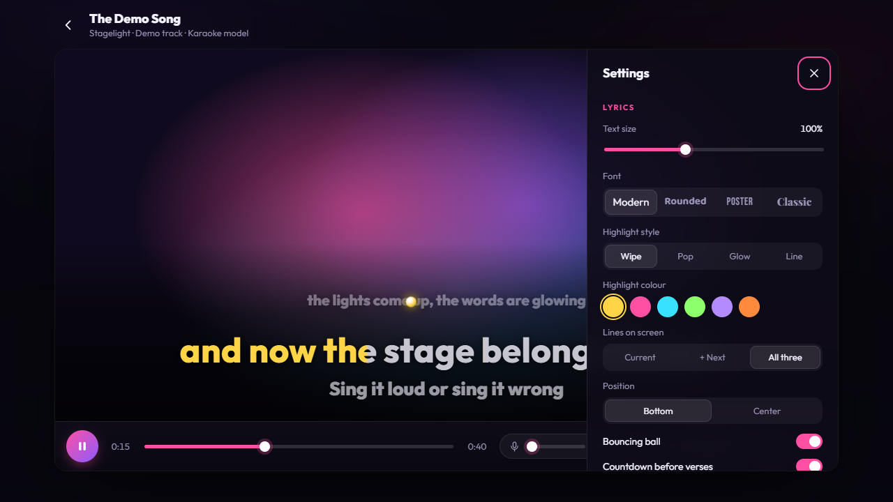
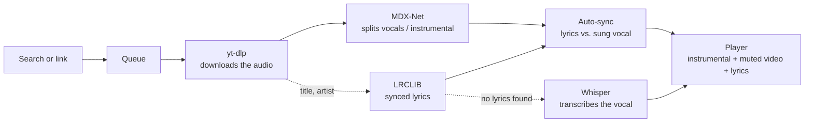

<p align="center">
  
</p>

<h1 align="center">Stagelight</h1>

<p align="center"><b>Search any song. Get karaoke.</b><br>
The vocals come out, the lyrics come in, and they light up word by word while the music video plays.</p>

<p align="center">
  <a href="https://github.com/bartoszkolo/stagelight/stargazers"></a>
  <a href="LICENSE"></a>
  
  
</p>

Stagelight turns any song on YouTube into a karaoke track on your own computer. An AI model strips
the lead vocal, synced lyrics are fetched and lined up with *that exact video*, and you sing along
with the music video in the background. **No account, no upload, no subscription. One command to start.**

<table>
  <tr>
    <td width="50%"></td>
    <td width="50%"></td>
  </tr>
  <tr>
    <td align="center"><i>Fullscreen, Glow style</i></td>
    <td align="center"><i>Everything is adjustable</i></td>
  </tr>
</table>

## Download

| Windows | macOS | Linux |
|---|---|---|
| [**Stagelight-win-x64.exe**](https://github.com/bartoszkolo/stagelight/releases/latest/download/Stagelight-win-x64.exe) | [**Apple Silicon**](https://github.com/bartoszkolo/stagelight/releases/latest/download/Stagelight-mac-arm64.dmg) · [Intel](https://github.com/bartoszkolo/stagelight/releases/latest/download/Stagelight-mac-x64.dmg) | [**AppImage**](https://github.com/bartoszkolo/stagelight/releases/latest/download/Stagelight-linux-x86_64.AppImage) · [.deb](https://github.com/bartoszkolo/stagelight/releases/latest/download/Stagelight-linux-amd64.deb) |

The installer is about 150 MB. On first launch Stagelight downloads its AI engine (about 700 MB,
once) into your user folder, which takes a few minutes. Then it opens with a built-in song you can
sing straight away.

The apps aren't code-signed (that costs money), so your system asks before the first launch:
**Windows:** *More info* → *Run anyway*. **macOS:** right-click the app → *Open*; if it says the
app is damaged, run `xattr -cr /Applications/Stagelight.app`. **Linux:** `chmod +x Stagelight-*.AppImage`.

## Run from source

You need **Python 3.10–3.12** and **[Node.js](https://nodejs.org) or [Deno](https://deno.com)**
(YouTube downloads need a JavaScript runtime). [uv](https://docs.astral.sh/uv/) makes the install
faster if you have it, but it's optional.

```bash
git clone https://github.com/bartoszkolo/stagelight.git
cd stagelight
./start.sh            # macOS / Linux
# Windows: powershell -ExecutionPolicy Bypass -File start.ps1
```

The first run installs everything (a few minutes). Your browser then opens at
**http://localhost:8765**. Search for a song (or paste a YouTube link), then press **Sing**, or
**+ Queue** a few songs and let them process in the background while you sing the first one.
Not ready to wait? Click **Try the demo**, which plays instantly.

## How it works



1. **Download.** `yt-dlp` fetches the audio track of the video.
2. **Separate.** An [MDX-Net](https://github.com/nomadkaraoke/python-audio-separator) model splits it
   into a vocal stem and an instrumental. It runs locally on your CPU or GPU.
3. **Find the lyrics.** Stagelight guesses artist and title from the video and asks
   [LRCLIB](https://lrclib.net), a free database of time-synced lyrics.
4. **Line them up with this video.** Music videos often have intros and skits the album version
   doesn't, so LRCLIB timings are usually off by a few seconds. Stagelight compares *when someone is
   actually singing* in the separated vocal with *when each lyric line should start*, and shifts
   the lyrics to match. No lyrics online? [faster-whisper](https://github.com/SYSTRAN/faster-whisper)
   transcribes the vocal stem, with word timings.
5. **Sing.** The instrumental is the master clock. The YouTube video plays muted and is kept in
   sync, and the lyrics are drawn on top.

Everything is cached, so a song you've done once opens instantly next time.

## Features

- **Search YouTube from inside the app.** No API key and no copying links. Results show whether a
  song is already in your library.
- **A processing queue.** Add a whole evening's songs: they're processed one after another in the
  background, each with live progress and time left, and ready ones get a **Sing** button.
- **Word-by-word highlighting** in four styles: *Wipe*, *Pop*, *Glow* and *Line*.
- **A bouncing ball** that lands on each word as you should sing it, plus countdown dots before
  each verse and "Lyrics in 0:24" during long intros.
- **A vocal slider.** 0% is pure karaoke. Push it to 20% to get a quiet guide vocal when you
  don't know the song, or 100% for the original.
- **Lyric sync nudging** with `[` and `]`. The correction is remembered per song.
- **Real fullscreen** with controls that fade out, for the TV at a party.
- **Settings for everything:** text size, four fonts, six highlight colours, one to three lines
  on screen, bottom or centre position, dim or blur the video, music volume.
- **Three separation models.** Switch between them on the same song instantly, once processed.
- **Library** of everything you've made, with thumbnails and instant search (press `/`).
- **Honest progress.** A real percentage and time-left estimate while vocals are removed, also
  shown in the browser tab title.

## Separation models

| Model | What it does | 30 s of audio on a laptop CPU* |
|---|---|---|
| **Karaoke** (default) | Removes the lead vocal and **keeps backing vocals**, like a real karaoke track. `UVR_MDXNET_KARA_2` | ~85 s |
| **Clean instrumental** | Removes every vocal, harmonies included. `UVR_MDXNET_9482` | ~84 s |
| **High quality** | Cleanest instrumental, fewest artefacts. `UVR-MDX-NET-Inst_HQ_3` | ~104 s |

\* Measured on an Intel i5-10310U (4 cores, 15 W, no GPU) at low process priority. A full 3–4
minute song with the default model takes **about 5–8 minutes** end to end on that machine. With an NVIDIA GPU
(`pip install "audio-separator[gpu]"`) it's a small fraction of that.

> **Why not the newest Roformer models?** They sound better, but on that same laptop CPU, with
> default settings, one 30 s clip was on track for nearly an hour. If you have a GPU, they're one line away in `pipeline.py`
> (`SEPARATION_MODELS`). PRs adding a GPU auto-detect are very welcome.

## Keyboard shortcuts

| Key | Action |
|---|---|
| `Space` | Play / pause |
| `←` `→` | Back / forward 5 seconds |
| `[` `]` | Lyrics earlier / later by 0.2 s |
| `F` | Fullscreen |
| `S` | Settings |
| `Esc` | Close settings / leave fullscreen |
| `/` | Search your library (home screen) |

## Troubleshooting

- **"Couldn't download from YouTube"**. Update yt-dlp: `.venv/bin/pip install -U yt-dlp`
  (Windows: `.venv\Scripts\pip install -U yt-dlp`). Also make sure Node.js or Deno is installed.
  YouTube changes things often, and yt-dlp usually fixes it within days.
- **The lyrics are a bit early or late.** Use `[` / `]` or the Sync buttons. The value is saved
  for that song.
- **Wrong lyrics, or none.** LRCLIB didn't have the song, or the video title was hard to parse.
  Stagelight then falls back to Whisper, which is decent but not perfect on singing.
- **"This video can't be embedded".** Some labels block embedding. Stagelight shows the video
  thumbnail instead and the karaoke still works.
- **It's slow.** That's the vocal separation on CPU. Pick a model and let it run in the
  background. The browser tab title shows the progress.

## Project layout

```
server.py        FastAPI app: job queue, library, static files
pipeline.py      download → separate → lyrics → align
static/          the whole front end (vanilla JS, no build step)
static/demo/     demo song: original lyrics and a synth backing track
data/            your songs: stems, lyrics, cache (git-ignored)
models/          separation models, downloaded on first use (git-ignored)
```

## Roadmap

Ideas, roughly in order. Contributions very welcome.

- [ ] **Vocal separation in the browser** with WebGPU (onnxruntime-web), so a decent GPU makes it near instant
- [ ] Sample-locked stems with the Web Audio API (one 4-channel file, no drift between vocal and music)
- [ ] Real per-word timing via forced alignment, instead of spreading a line's time across its words
- [ ] Key and tempo control
- [ ] Microphone with reverb, recording your take, and pitch scoring against the original vocal
- [ ] Party mode: a queue with singer names, add songs from your phone over Wi-Fi
- [ ] A lyrics editor for fixing timings by tapping along

## Legal

Stagelight is a tool for **personal, private use**. It runs entirely on your computer and hosts
nothing. Downloading from YouTube may be against YouTube's Terms of Service where you live, and
songs, music videos and lyrics belong to their rights holders. Don't redistribute the stems or
lyrics it produces, and don't run it as a public service. Lyrics come from
[LRCLIB](https://lrclib.net).

**Built-in song:** [“Crazy Glue” by Josh Woodward](https://www.joshwoodward.com/song/CrazyGlue) is
licensed [CC BY 4.0](https://creativecommons.org/licenses/by/4.0/). Stagelight ships it with the lead
vocal separated out (`static/songs/crazy-glue/`, made with `tools/bundle_song.py`). The tiny synth
demo in `static/demo/` (lyrics and music) is original and MIT-licensed like the rest of the code.

## Credits

Built on the shoulders of
[yt-dlp](https://github.com/yt-dlp/yt-dlp),
[python-audio-separator](https://github.com/nomadkaraoke/python-audio-separator) and the
[Ultimate Vocal Remover](https://github.com/Anjok07/ultimatevocalremovergui) community's MDX-Net models,
[LRCLIB](https://lrclib.net),
[faster-whisper](https://github.com/SYSTRAN/faster-whisper),
[FastAPI](https://fastapi.tiangolo.com) and the YouTube IFrame Player API.
Built in a couple of evenings with [Claude Code](https://claude.com/claude-code).

MIT © bartoszkolo
